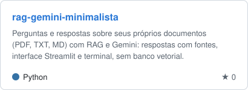
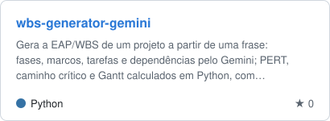
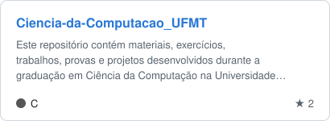
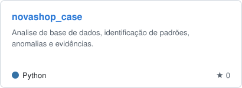
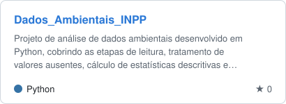
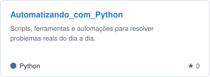
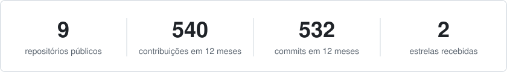
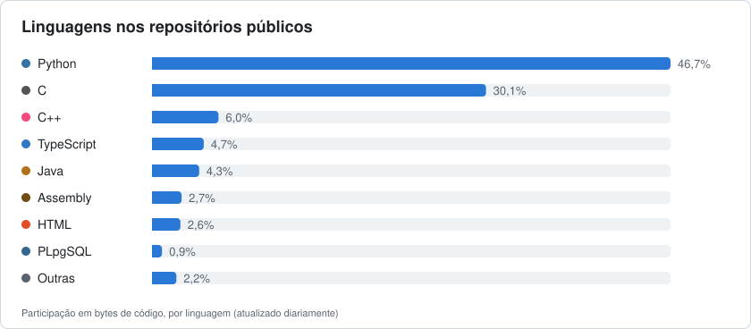

&nbsp;&nbsp;

---

## Sobre mim

Estudante de Ciência da Computação na **Universidade Federal de Mato Grosso (UFMT)**, com foco em **desenvolvimento back-end, dados e banco de dados**. Construo sistemas com intenção: cada repositório aqui representa uma etapa concreta da minha formação técnica, do fundamento ao stack profissional.

## Tecnologias

<table align="center">
  <tr>
    <th align="center" width="33%">Linguagens</th>
    <th align="center" width="33%">Back-end e dados</th>
    <th align="center" width="33%">Ferramentas</th>
  </tr>
  <tr>
    <td align="center"></td>
    <td align="center"></td>
    <td align="center"></td>
  </tr>
</table>

  
  
  
  
  
  

## Projetos em destaque

<table>
  <tr>
    <td width="50%">
      <a href="https://github.com/cavalcantiraissas/rag-gemini-minimalista">
        <picture>
          <source media="(prefers-color-scheme: dark)" srcset="assets/repo-rag-gemini-minimalista-escuro.svg">
          
        </picture>
      </a>
    </td>
    <td width="50%">
      <a href="https://github.com/cavalcantiraissas/wbs-generator-gemini">
        <picture>
          <source media="(prefers-color-scheme: dark)" srcset="assets/repo-wbs-generator-gemini-escuro.svg">
          
        </picture>
      </a>
    </td>
  </tr>
  <tr>
    <td width="50%">
      <a href="https://github.com/cavalcantiraissas/Ciencia-da-Computacao_UFMT">
        <picture>
          <source media="(prefers-color-scheme: dark)" srcset="assets/repo-Ciencia-da-Computacao_UFMT-escuro.svg">
          
        </picture>
      </a>
    </td>
    <td width="50%">
      <a href="https://github.com/cavalcantiraissas/novashop_case">
        <picture>
          <source media="(prefers-color-scheme: dark)" srcset="assets/repo-novashop_case-escuro.svg">
          
        </picture>
      </a>
    </td>
  </tr>
  <tr>
    <td width="50%">
      <a href="https://github.com/cavalcantiraissas/Dados_Ambientais_INPP">
        <picture>
          <source media="(prefers-color-scheme: dark)" srcset="assets/repo-Dados_Ambientais_INPP-escuro.svg">
          
        </picture>
      </a>
    </td>
    <td width="50%">
      <a href="https://github.com/cavalcantiraissas/Automatizando_com_Python">
        <picture>
          <source media="(prefers-color-scheme: dark)" srcset="assets/repo-Automatizando_com_Python-escuro.svg">
          
        </picture>
      </a>
    </td>
  </tr>
</table>

## Números

<picture>
  <source media="(prefers-color-scheme: dark)" srcset="assets/numeros-escuro.svg">
  
</picture>

<picture>
  <source media="(prefers-color-scheme: dark)" srcset="assets/linguagens-escuro.svg">
  
</picture>

Gerados por <a href="scripts/gerar_graficos.py"><code>gerar_graficos.py</code></a> com a API do GitHub · atualizados todo dia · só repositórios públicos

